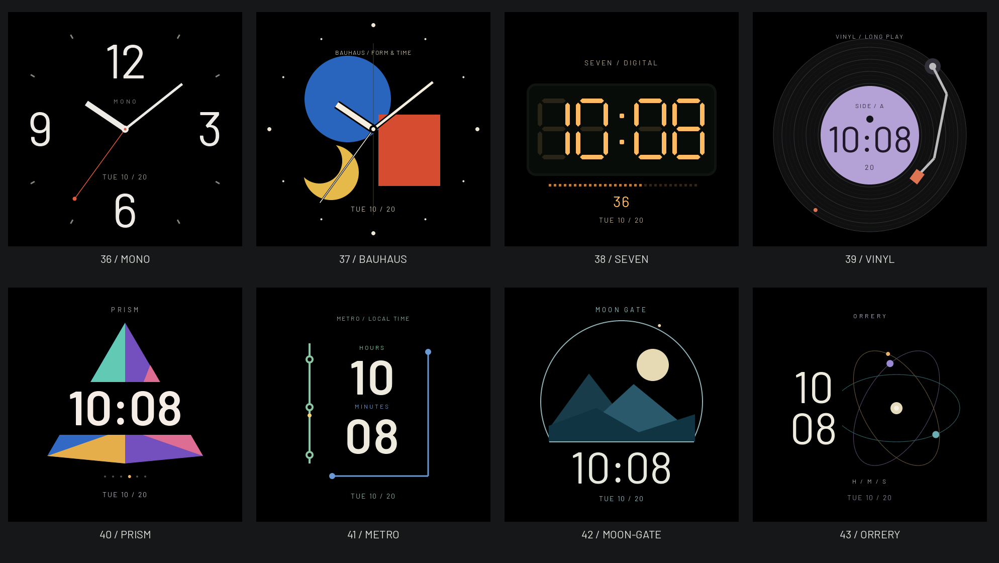

# 八款原生表盘 · 2026-10-22

用户已确认保留八款，并授权提交、官网部署及设备安装；发布结果以表盘说明中的后续回执为准。这些PNG来自真实LVGL固件绘制器，466px正常图、AOD及233px选择页共用生产代码，不是另画的网页示意。



| ID | 名称 | 视觉与时间表达 |
| --- | --- | --- |
| 36 | MONO / 留白 | 米白大刻度、真实时分针、红色秒针 |
| 37 | BAUHAUS / 构成 | 蓝圆、红方、黄色月牙与高对比指针 |
| 38 | SEVEN / 电子 | 琥珀色七段数码管与秒读数 |
| 39 | VINYL / 唱片 | 唱片沟槽、淡紫标签、数字时间与唱臂 |
| 40 | PRISM / 棱镜 | 彩色切面、数字负空间与滑动秒点 |
| 41 | METRO / 线路 | 双色线路、上下时分与移动秒点 |
| 42 | MOON GATE / 月门 | 月门、山形、米白数字与上弧秒点 |
| 43 | ORRERY / 星仪 | 三条时分秒轨道与左侧数字时间 |

唱片、地铁、月亮与星体只作构图意象，不提供音乐状态、交通、月相或天文数据。全部AOD仅保留分钟级时钟，不绘制活动装饰；旧36款的编号与绘制保持。

其他实图：[00:00](midnight-overview.png)、[23:59](late-overview.png)、[233px原生缩略图](preview-overview.png)、[中文选择页](selector-36-zh.png)、[英文选择页](selector-43-en.png)。每款的`<key>.png`和`<key>-aod.png`保留单独正常/AOD图；图上时间与日期为固定夹具数据。

验证摘要见[validation.json](validation.json)：5/5相关主机测试，736组全帧/分块一致，原36款102帧逐字节一致，ESP32-S3构建通过；本地中英文图鉴各44款，新八款共16次选择及1380/390/320px检查通过，无页面错误。未据此宣称真机栈余量、功耗、性能或主观设计通过。设备仍安装前一批36款候选。

从仓库根目录重现正常/AOD及边界合览（使用独立临时构建，结束后删除该构建）：

```bash
cmake -S GeekTool-IDF/tests/host -B /tmp/soround-atelier-review -DCMAKE_BUILD_TYPE=Debug
cmake --build /tmp/soround-atelier-review --target watchface_tests -j 6
python3 -B scripts/render_site_watchfaces.py --faces /tmp/soround-atelier-review/watchface_tests --review GeekTool-IDF/artwork/watchfaces/atelier-native-20261022 --review-from 36 --review-to 44
```

导出脚本复用实际原生帧，仅作PPM→PNG转换，原始临时PPM自动清理。233px选择页来自`settings_level_tests`导出，`preview-overview.png`使用实际233px区域拼版；没有将466px图缩小代替选择页验证。关键绘制和数据链路见[表盘说明](../../../WATCHFACES_UI.md)。
