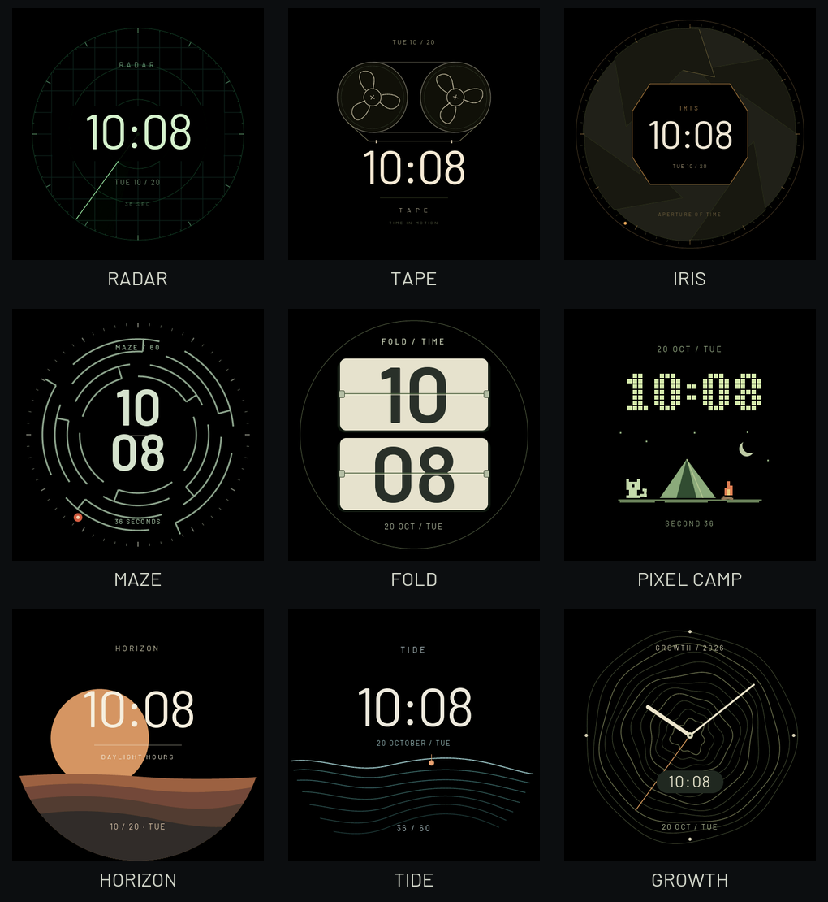

# STUDIO 黑底原生审阅

2026-10-21用户追加要求：九款背景纯黑，保留绘制对象和logo，允许调整对象配色。原设计稿与旧21款表盘保留。本组由最终生产renderer经LVGL9.6.0~1主机软件后端输出，不是手绘概念图或设备截图。

每款原始PNG为466×466，`*-aod.png`为对应常显；合览只按比例缩小用于审阅。固定参考时刻2026-10-20 10:08:36，真实固件仍使用系统时钟。MAZE改用浅绿/米白墨迹；其余主体配色保持，月牙镂空和IRIS内孔随背景变黑。HORIZON保留山体与日/月对象，FOLD保留翻页卡片，PIXEL CAMP保留猫/帐篷/火焰。

实际Controller/选择页共550张修改前后比较中402张相同，148张差异仅属于获批STUDIO正常/AOD及其两种入口预览。旧21款及非STUDIO页面逐字节相同。最终优化器另与未优化黑底参考比较2160帧全部相同；缓存申请失败路径再比较2160帧也全部相同，覆盖466/233px、正常/AOD及全部秒值/四组时分。

59项主机回归、2项生态箱/专注及ESP32-S3构建通过；还未据此认定设备流畅度、功耗、触摸或主观效果已验收。`validation.json`是页面比较范围；目标构建和任务计数回执在忽略目录`build/perf-all-20261021/evidence/`，逻辑与限制归[表盘说明](../../../WATCHFACES_UI.md)及[本地候选记录](../../../PORTING_NOTES.md#2026-10-21-全量流畅性优化与黑底表盘本地候选)。
