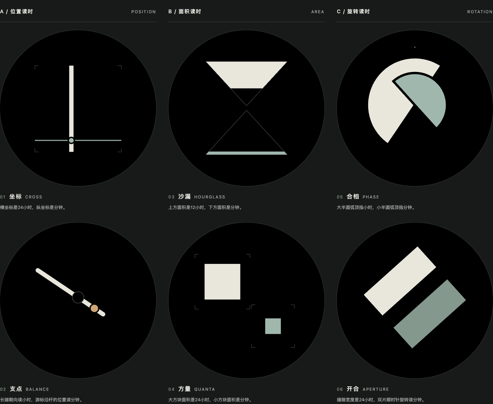

# 几何读时 · 六款概念效果

2026-10-22，按用户“更有意思、极简、用几何图形表达时间，先看效果”的要求制作。用户已确认六款全部保留并授权接入、提交、部署及安装；已接入原生目录ID56–61，提交`cc08558`、62款官网部署及设备安装均已完成，详见[原生审阅](../geometry-native-20261022/README.md)。本目录保留概念稿及其生成时的浏览器验证，不冒充原生截图。

[离线交互预览](preview.html)可直接在浏览器打开，切换四个样例、拖动时分、单独查看一个方向，或开启很小的辅助数字。默认关闭数字，不增加日期、品牌或传感器装饰。参考画面均为466×466圆屏，属于浏览器SVG概念，不是LVGL或真机截图。

| 方向 / 名称 | 几何读法 |
| --- | --- |
| A / 01 坐标 CROSS | 交点横坐标从左到右表示0–24小时，纵坐标从下到上表示0–60分钟；小时带分钟小数 |
| A / 02 支点 BALANCE | 非对称杆的长端朝向按12小时钟面读时，暖色游标从短端到长端按0–60分钟移动 |
| B / 03 沙漏 HOURGLASS | 上三角填充面积为12小时进度，下三角填充面积为分钟进度；零点保留空轮廓 |
| B / 04 方量 QUANTA | 大小两个方块的面积分别表示24小时和分钟，四角标记是各自满量边界 |
| C / 05 合相 PHASE | 大、小半圆的弧顶分别朝向12小时、60分钟钟面角度，沿顺时针旋转；不表达月相 |
| C / 06 开合 APERTURE | 缝隙按24小时从6px逐渐打开到108px，双片每60分钟顺时针转一圈；整点浅片在左、深片在右，异色区分180度方向 |

12小时方案本身不区分上午/下午；可打开辅助读数查看24小时时间。坐标与面积需要熟悉比例，更偏艺术读时，不宣称可直接精确读到每分钟。辅助数字只是精读选项，所有图形在关闭数字时仍由相同时间输入驱动。

`geometry.js:svg`是所有画面的唯一绘制来源，`preview.js`仅绑定输入与方向筛选，没有计时器、网络、设备或存储操作。`render.mjs`导出六张SVG、十八张边界SVG、三个方向入口及自包含`preview.html`；以后修改源后运行`node render.mjs`同步导出。

面积换算：对底边朝外的三角形，填充深度`d = H × (1 − sqrt(1 − p))`；对正方形，边长`side = max × sqrt(p)`。不能将高度或边长直接按比例缩放后称为面积进度。两方块的最大边界不相交，避免遮挡使可见面积失真。开合的双色片用于消除半圈后形状相同的歧义。

检查包括真实浏览器四组时刻、三方向筛选、辅助数字和键盘滑杆；1518/768/390/320px无横向溢出。独立用实际SVG多边形的鞋带公式和矩形宽高核对填充面积，8640组时分组合均无非有限几何值。正常图、[00:00](midnight-overview.png)、[23:59](late-overview.png)已查看；详细回执见`validation.json`。不据此宣称固件性能、息屏或真机效果通过。

本轮预览服务和浏览器测试页结束后关闭，源稿与最终审阅图片保留。
