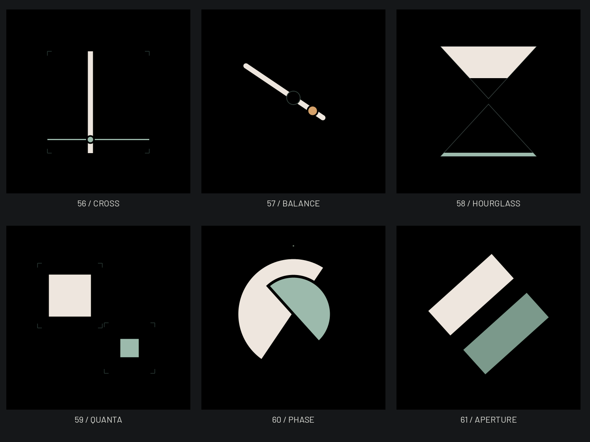

# 六款几何读时 · 已部署及安装

2026-10-22：用户确认六款概念全部保留，授权接入表盘库、提交推送、官网部署及设备安装。新ID56–61依次为坐标CROSS、支点BALANCE、沙漏HOURGLASS、方量QUANTA、合相PHASE、开合APERTURE；总62款、STUDIO41款。读时规则沿用[已确认概念](../geometry-exploration-20261022/README.md)，正常态保持默认无辅助数字；概念页的数字开关是审阅工具，不新增设备设置。

[00:00](midnight-overview.png)、[23:59](late-overview.png)、[真实233px预览](preview-overview.png)、[中文设置](selector-56-zh.png)、[英文独立入口](app-selector-61-en.png)。图像由真实LVGL绘制器导出，正常样例10:08:36，日期固定2026-10-20；不代表当前设备屏幕或实时数据。

`watchface_geometry.c:watchface_geometry_render`按kind0–5分发。只读取时间快照，按分钟重绘；AOD在图形前返回通用低亮信息，隐藏/休眠和选择保存沿用原控制器。12小时的支点/沙漏/合相本身不区分AM/PM。沙漏的填充深度、方量的边长用平方根保持可见面积线性；开合双色消除180度方向歧义。合相以解析半平面/圆交集扫描，复用现有有界scratch和span，不增加弧点数组、独立缓存或字体。

5/5相关主机测试通过；覆盖六款的坐标、面积、方向、分钟刷新与62款两个入口/保存/首尾循环。1312组STUDIO全帧与40行双缓冲一致，覆盖两种565色序、466/233px、正常/AOD与四组边界时刻；旧56款233张参考帧逐字节一致。ESP32-S3普通镜像`v1.7-beta.37-geometry6`构建通过，5,428,656B；静态单函数栈不代替真机任务余量。中英文官网本地124次选择及62/30/32筛选、键盘、1380/390/320px检查通过。回执见[validation.json](validation.json)，功能提交`cc08558`已按相同Git对象哈希推送，[Pages39732510280](https://github.com/soBigRice/soRound_os/actions/runs/39732510280)部署成功；101个公开文件与本地构建逐字节一致，源站首页与index均为62款、SHA相同。当前版本中英文124次选择、62/30/32筛选、Enter及语言锚点检查通过，1380/390/320px无横向溢出，无页面错误。

隔离真机轮测保留9216B生产LVGL任务栈，六款全屏、独立App预览、设置预览各两轮（每项12次），6款AOD、跨分钟与休眠唤醒完成；173.37秒无监测fault，最低LVGL可用栈3064B。随后安装普通`v1.7-beta.37-geometry6`（5,428,656B，SHA-256 `1ccd610264edd5c17dd887d5c5b669fdf1d4f8965ccfdcae4c9b44a362a8f7d1`），ELF无探针符号；70.20秒启动观察通过，core/check与首页首帧正常，启动期间心跳推进。新鲜串口回读ota_1序号64为VALID，两份OTA记录CRC有效；设备镜像MD5匹配，NVS逐字节保持，bootloader/分区/beta.35整个恢复槽/完整文件区校验不变。上述记录不代替解码峰值RAM、帧率、功耗及主观真机观感/触摸验收。未创建公开固件Release，官网继续标记公开已有30款、未公开32款。

复现：使用临时主机构建的`watchface_tests`执行`python3 -B scripts/render_site_watchfaces.py --faces <binary> --review GeekTool-IDF/artwork/watchfaces/geometry-native-20261022 --review-from 56 --review-to 62`。PNG仅转换实际PPM像素，233px从两个真实选择入口裁切，不用466px缩放替代。
