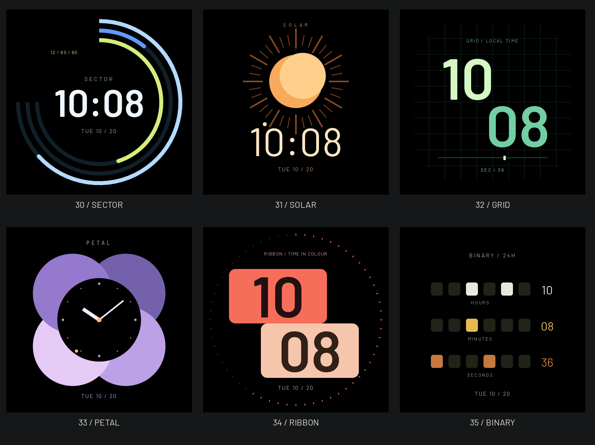

# STUDIO 图形六款 · 原生审阅

2026-10-22设计已由用户确认；功能提交`83ba596`已推送，官网部署及`v1.7-beta.37-faces6`设备安装完成，尚未创建公开固件Release。ID30–35为SECTOR、SOLAR、GRID、PETAL、RIBBON、BINARY，既有30款保留。图片来自真实`watchface_graphic_render`经LVGL主机RGB565后端输出，固定样例时间2026-10-20 10:08:36；不是网页重画或设备照片。



每款`<name>.png`为466×466正常态，`<name>-aod.png`为常显；合览只组合原始图，不改变图内像素。正常态使用真实时分秒，常显在装饰前返回静态核心时间。二进制每行从左到右权值32/16/8/4/2/1，旁边保留十进制数值。

调用链、验证范围和未验证项归[表盘说明](../../../WATCHFACES_UI.md)，小型回执为`validation.json`。重建方式：

```bash
python3 -B scripts/render_site_watchfaces.py --faces <host-build>/watchface_tests --review GeekTool-IDF/artwork/watchfaces/graphic-native-20261022
```

脚本自动清除中间PPM；另将STUDIO十五款同步至官网`site/assets/studio/`。全屏/预览与分块一致性通过不等于真机功耗、栈余量、刷新观感或用户已验收。

设备轮测174.14秒：六款正常态及两个真实选择入口各两轮、六款AOD、跨分钟和休眠唤醒全部通过，最低LVGL可用栈3064B。最终普通固件70.09秒启动自检/首页通过，新鲜启动记录为ota_1/seq52/VALID；设置与最新安装前快照相同，恢复槽和文件区保持。主观真机观感、触摸及功耗仍未作为已验收结论。官网中英文和75个公开文件已验证，详情见同目录`validation.json`及模块说明。
