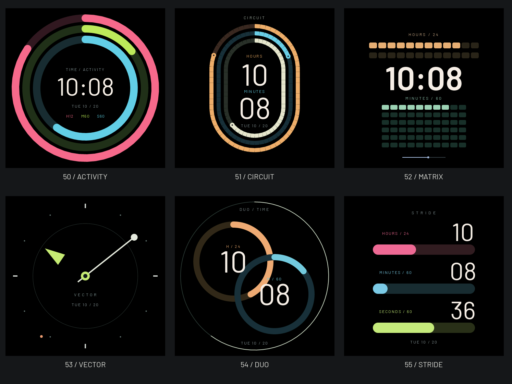

# 六款运动图形 · 原生候选

2026-10-22：按用户要求，用运动表盘的图形语言表达时间，追加ID50–55。当前已接入本地表盘库和官网目录，用户已确认设计并授权提交、官网部署及设备烧录，发布结果以表盘说明及验证回执为准。

| ID / 名称 | 时间编码 |
| --- | --- |
| 50 ACTIVITY / 律动 | 红/绿/蓝三环分别为12小时、分钟、秒 |
| 51 CIRCUIT / 赛道 | 三条轨道对应12小时、分钟、秒；中心24小时数字辅助读时 |
| 52 MATRIX / 阵列 | 24格小时、60格分钟按整数点亮，秒标记沿底部滑动 |
| 53 VECTOR / 矢量 | 三角小时标、白色分针与圆点、橙色秒点 |
| 54 DUO / 双环 | 橙色24小时环、蓝色分钟环、外细秒环 |
| 55 STRIDE / 步幅 | 三条进度带与真实时、分、秒数字 |

H/M/S始终表示时、分、秒，不代表步数、心率、热量、GPS或运动记录。正常活动态1Hz，AOD返回静态分钟钟面；无新服务、线程、计时器或模块持有的全屏画布。所有画面由实际LVGL固件代码绘制，不是网页重画。

其他实图：[00:00](midnight-overview.png)、[23:59](late-overview.png)、[233px预览](preview-overview.png)、[中文设置](selector-50-zh.png)、[英文独立入口](app-selector-55-en.png)。正常固定2026-10-20 10:08:36；选择器使用固定样例。检查时将赛道日期移入内轨安全区，矢量时标放到分针圆点之外，避免午夜遮挡。

5/5主机测试通过；`sport_time_contract`在06:30:15核对三环、格点及条形的实际点亮边界。35款STUDIO在两种色序、466/233px、正常/AOD和四组边界下1120组整帧/分块一致，原44款134参考帧等价，ESP32-S3构建通过。具体摘要见[validation.json](validation.json)，新十二款的设备栈、峰值RAM、性能、功耗与主观体验仍待验证。

复现导出：用临时主机构建的`watchface_tests`运行`python3 -B scripts/render_site_watchfaces.py --faces <binary> --review GeekTool-IDF/artwork/watchfaces/sport-native-20261022 --review-from 50 --review-to 56`。PNG只转换原生PPM格式；233px图来自真实选择器区域。详细入口、生命周期及资源约束见[表盘说明](../../../WATCHFACES_UI.md)。
