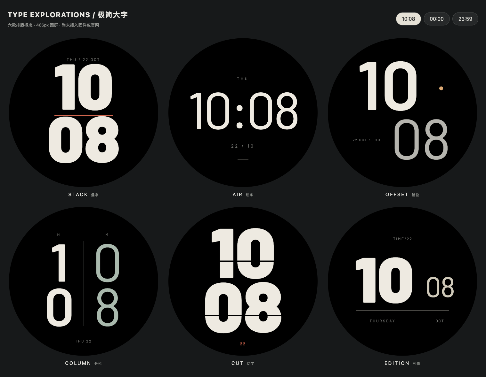

# 极简大字 · 六款排版概念

后续状态（2026-10-22）：用户已要求六款全部接入，当前本地原生实现为ID44–49，见[原生审阅](../type-native-20261022/README.md)。以下HTML、SVG、PNG及validation.json保留原稿生成时的概念状态；用户已确认原生设计并授权提交、官网部署及设备安装；进展以原生版本说明为准。

2026-10-22：用户确认上一批八款并授权提交、部署及烧录，同时要求继续探索极简字体、大数字与设计感。这一组单独作为设计概念，尚未接入固件目录、部署、烧录或由用户验收；设备和官网的44款版本不包含它们。

| 名称 | 排版重点 |
| --- | --- |
| STACK / 叠字 | Black粗体上下叠排，红色短分隔线 |
| AIR / 细字 | 细字横排大时间，保留大面积留白 |
| OFFSET / 错位 | 时分错位、字重对照与单点暖色 |
| COLUMN / 分栏 | 左小时右分钟，竖向数字与浅绿对照 |
| CUT / 切字 | 两行超大字，水平负空间切口 |
| EDITION / 刊物 | 大小时配小分钟，以细线组织日期 |

可编辑源是`generate.py`与各款SVG；运行`python3 -B GeekTool-IDF/artwork/watchfaces/type-exploration-20261022/generate.py`重新生成页面和三组时间样例。字体复用已有Barlow Regular / SemiBold / Black，许可见[OFL](../fonts/OFL.txt)；用fontTools生成嵌入WOFF子集，避免SVG作为图片时外部字体不加载导致假预览。没有外部服务或新运行时依赖。若后续接入固件，需要另生成对应大字号及半尺寸字库，并验证原生渲染、AOD和设备栈，不能把本组SVG当成已实现的LVGL效果。

`index.html`提供10:08、00:00、23:59三个时间按钮，支持键盘Enter。`proof.png`保留正常与两组边界时刻的浏览器整页实图，六款PNG来自其中466px图像区域；`validation.json`记录三组共18张样例加载、键盘和1518/390/320px无溢出检查。图上日期与时间为样例。

审阅时修正了日期与大数字的叠层、宽00小时和小分钟的间距；午夜及23:59已复核。图片切换须先同步更新整组地址，由浏览器加载；事件中逐张等待解码会出现短暂半更新，快速切换还可能取消旧解码Promise。最终入口使用同步地址赋值，验证时等待完整目标图片加载；不通过吞掉解码异常掩盖坏资源。

本组仅保留源稿、最终审阅图及小型回执；预览服务、浏览器页和临时缓存结束后清理。
