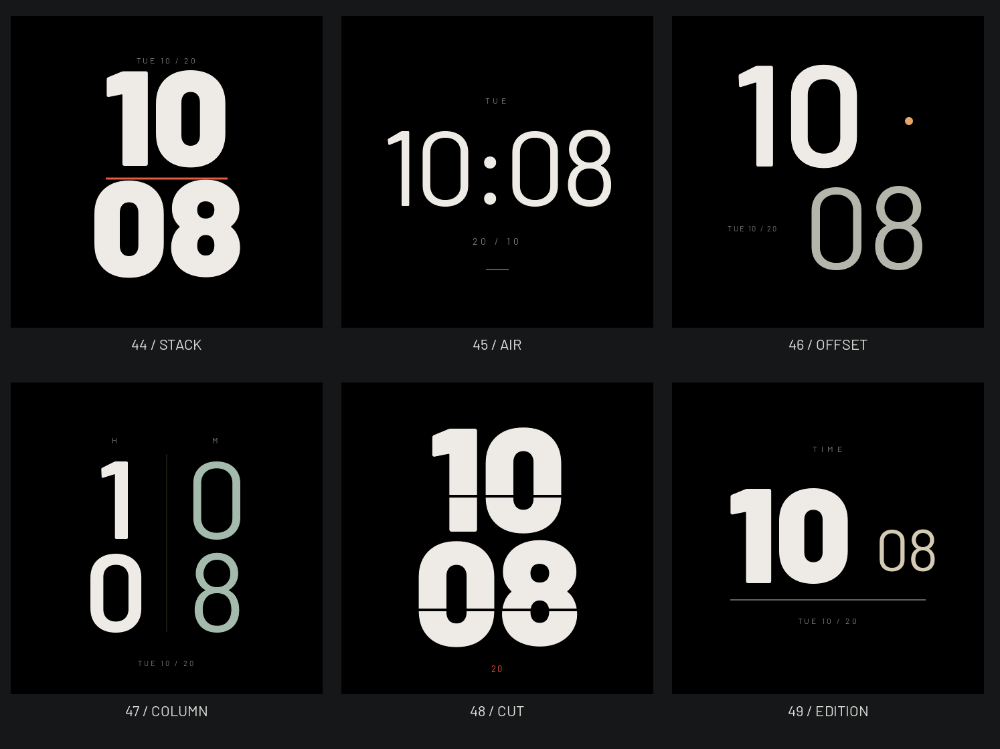

# 六款极简字体 · 已部署及安装

2026-10-22：按用户要求将[六款原稿](../type-exploration-20261022/README.md)接入本地目录，ID44–49为STACK、AIR、OFFSET、COLUMN、CUT、EDITION。用户已确认设计；功能提交`3bc1963`已推送，官网56款已部署，包含新增十二款的普通56款固件已安装。发布结果见表盘说明及本批验证回执。

独立OFL Barlow字库保留Black/Regular/SemiBold字重和正屏/半尺寸字号；日期读取真实快照，纯排版只按分钟重绘。AOD在大字绘制前返回通用低亮信息，不渲染大字号。原44款编号、字体文件和像素保持。

边界及真实选择器：[00:00](midnight-overview.png)、[23:59](late-overview.png)、[233px预览](preview-overview.png)、[中文设置](selector-44-zh.png)、[英文独立入口](app-selector-49-en.png)。正常参考固定2026-10-20 10:08:36，选择器为另一套固定夹具；所有时间、日期都是样例。

5/5相关主机测试、8组共16个字库的真实字形检查、1120组STUDIO整帧/分块比较、原44款134帧等价以及ESP32-S3构建通过；摘要见[validation.json](validation.json)。隔离真机轮测保留9216B生产LVGL任务栈，十二款全屏、独立App预览及设置预览各两轮（每项24次），12款AOD、跨分钟与休眠/唤醒完成；233.86秒无监测fault，最低LVGL可用栈3000B。随后安装普通`v1.7-beta.37-type-sport12`（5,417,840B，SHA-256 `107775ec420976226dc47e6329a823933b36cd57e1d2e6697969738665c0a3d5`），ELF无探针符号；70.19秒观察通过，启动core/check与首页首帧正常，启动期间心跳推进。新鲜串口回读ota_1为序号60、VALID，两份OTA记录CRC正确；设备镜像MD5与本地一致，NVS逐字节保持，bootloader/分区/beta.35恢复槽/完整文件区校验不变。上述记录验证本批安装与运行路径，未测解码峰值RAM、帧率、功耗，也不代替主观真机观感/触摸验收。未创建公开固件Release，官网继续标记公开已有30款、未公开26款。

复现：先运行`python3 -B GeekTool-IDF/tools/gen_watchface_fonts.py --typography`生成独立字体，使用临时主机构建的`watchface_tests`执行`python3 -B scripts/render_site_watchfaces.py --faces <binary> --review GeekTool-IDF/artwork/watchfaces/type-native-20261022 --review-from 44 --review-to 50`。导出仅做原生PPM→PNG转换；233px图来自真实选择器裁切，未缩放466px替代。结束后删除自己的临时构建和原始PPM。
